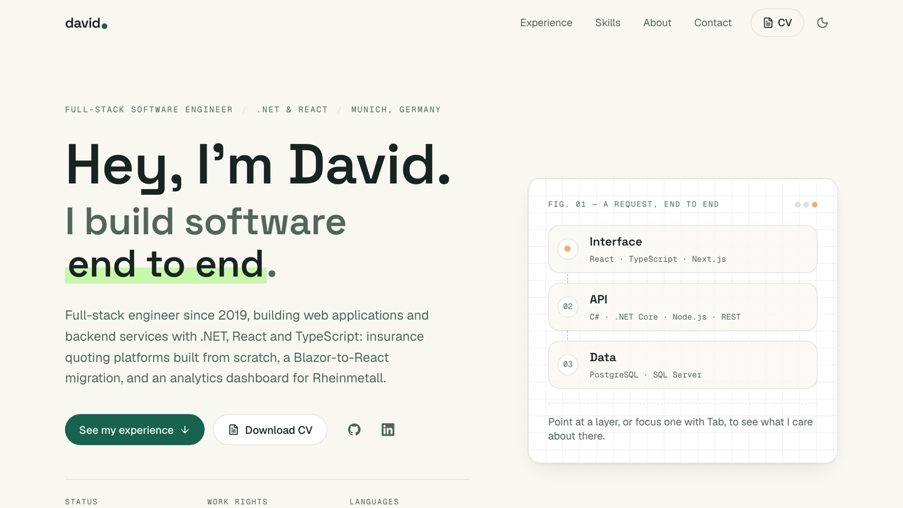

# davidlescano.com

My personal website: who I am, what I've built, and how to reach me.

**[davidlescano.com](https://davidlescano.com)**

[](https://github.com/davidlescanoar/davidlescano.com/actions/workflows/ci.yml)

<picture>
  <source media="(prefers-color-scheme: dark)" srcset=".github/assets/preview-dark.jpg" />
  
</picture>

## Built with

Next.js 16 · React 19 · TypeScript · Tailwind CSS 4 · Vercel

## What's inside

- **Fully static.** Every page is prerendered HTML: no backend, no database, no cookies.
- **Fast and accessible.** Scores 100 on Lighthouse for performance, accessibility and SEO, with budgets checked on
  every push.
- **Tested like a product.** Unit tests, plus Playwright end-to-end tests on desktop and mobile with an axe
  accessibility scan of every page in light and dark mode.
- **Honest by design.** Tests fail if the content claims something it shouldn't, and empty sections stay hidden instead
  of showing placeholders.
- **Light and dark theme** that follows the system setting, with no flash on load.

## Run it locally

```bash
nvm use        # Node 26
npm install
npm run dev    # http://localhost:3000
```

Before pushing, `npm run check` runs typecheck, lint, formatting, tests and the build. `npm run test:e2e` runs the
browser tests against that build.

## Update the content

All content lives in a few typed files, no component changes needed:

| What                   | Where                     |
| ---------------------- | ------------------------- |
| Name, links, languages | `src/config/site.ts`      |
| Experience             | `src/data/experience.ts`  |
| Skills                 | `src/data/skills.ts`      |
| Projects               | `src/content/projects.ts` |
| Notes                  | `src/content/writing.ts`  |

Projects and notes appear on the site as soon as the first one is published.
